# 30DayMapChallenge 2025
Este es mi repositorio donde guardaré los códigos para hacer los mapas para el challenge.

Autor: Fernando Dorantes Nieto

Los mapas y demás se podrán ver en esta página web:
[FerDoranNie 30 Day Map Challenge 2025](https://ferdorannie.github.io/-Repo30DayMapChallenge2025/)

## Día 1:
### Mapa del día y noche en tiempo real
#### Software utilizado:
- Javascript

#### Origen de los datos 
No hay datos que alimenten este mapa, se tomó inspiración
de un trabajo de Mike Bostock: [Mapa Dia noche Bostock](https://observablehq.com/@d3/solar-terminator)

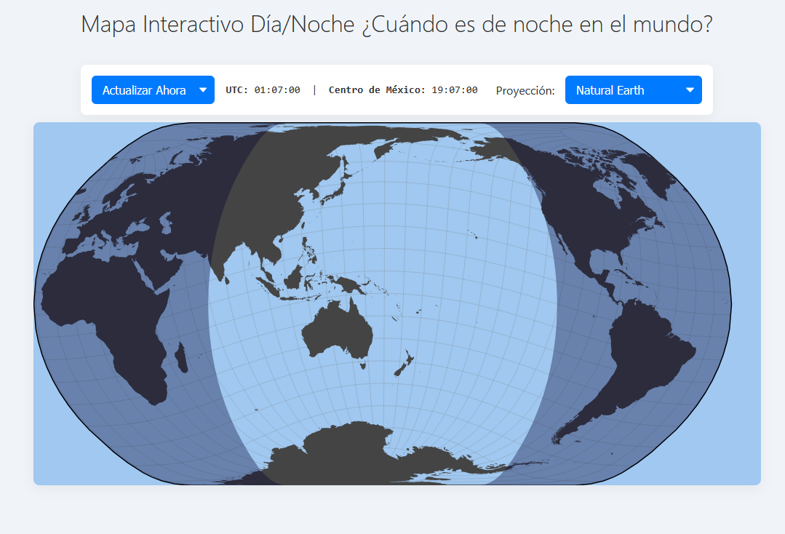

## Día 2:
### Siembra de maiz por municipio en México
#### Software utilizado:
- Python
- Tableau

#### Origen de los datos 
[Datos Inegi](https://gaia.inegi.org.mx/)

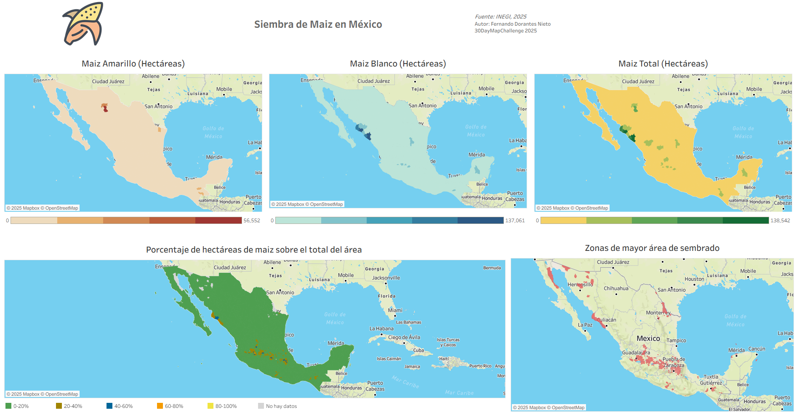
[Link a Tableau Public](https://public.tableau.com/views/Mapa_maiz_mexico/SiembradeMaizMexico?:language=en-US&publish=yes&:sid=&:redirect=auth&:display_count=n&:origin=viz_share_link)

## Día 3:
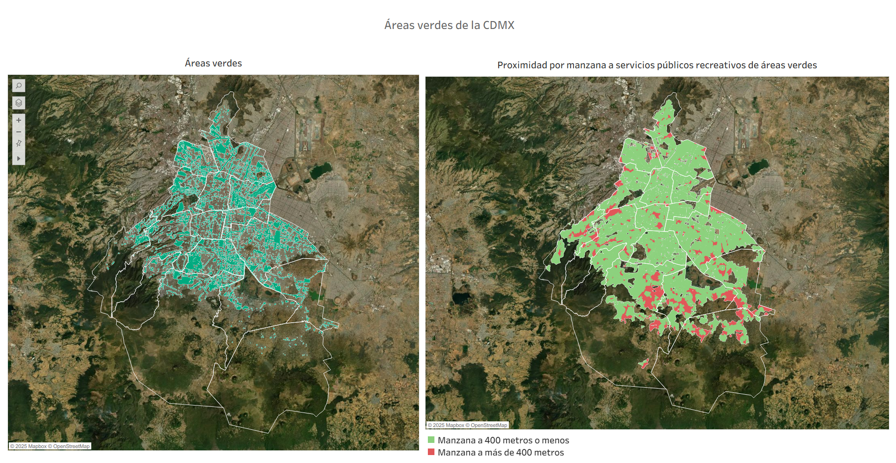

## Día 4:
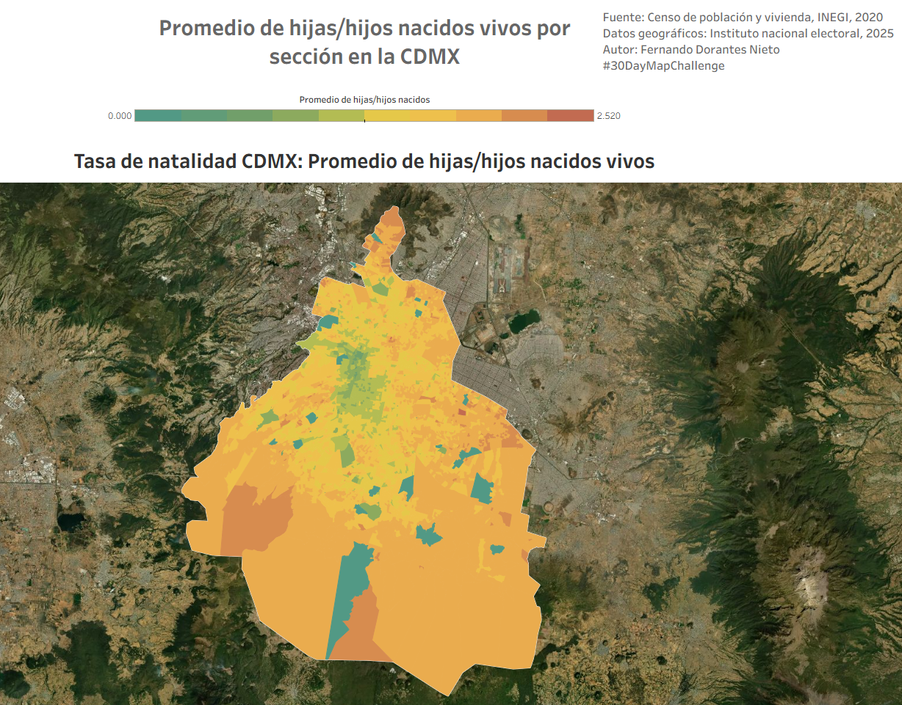

## Día 5:
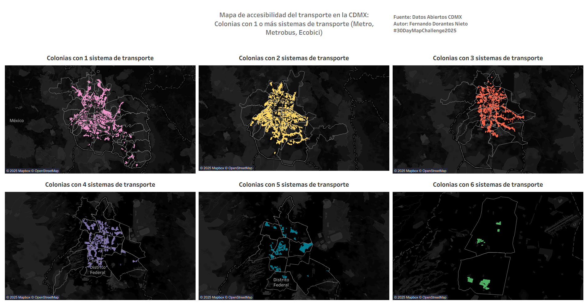

## Día 6:
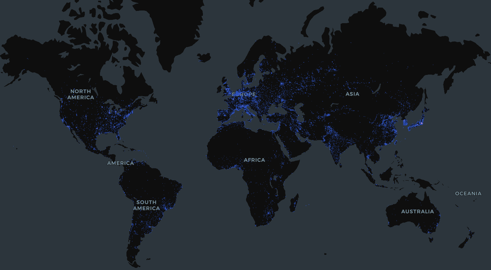

## Día 7:
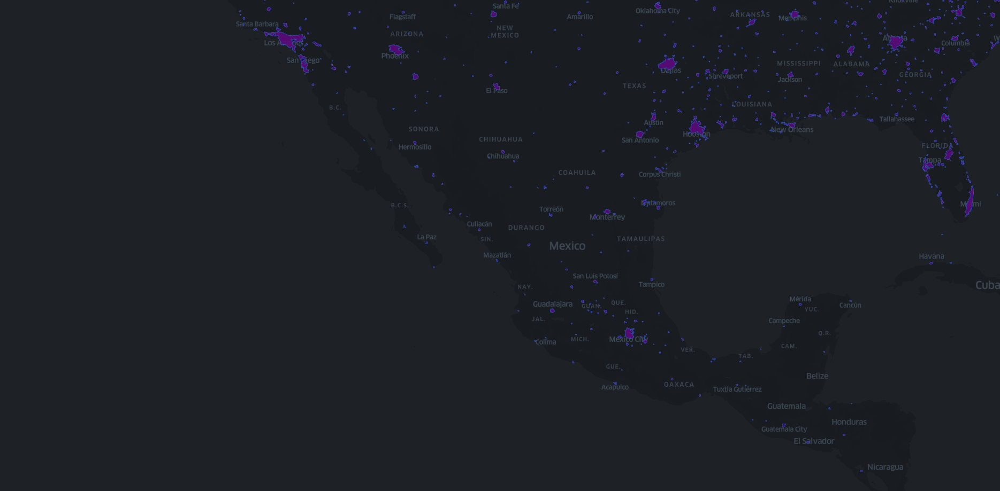

## Día 8:

## Día 9:

## Día 10:

## Día 11:
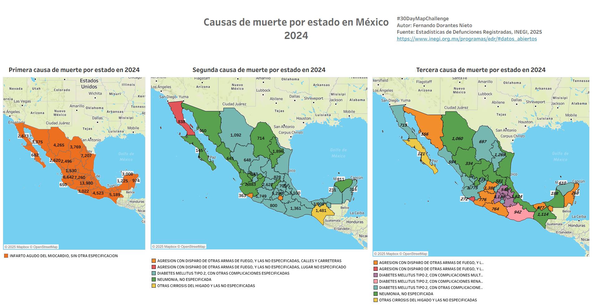

## Día 12:
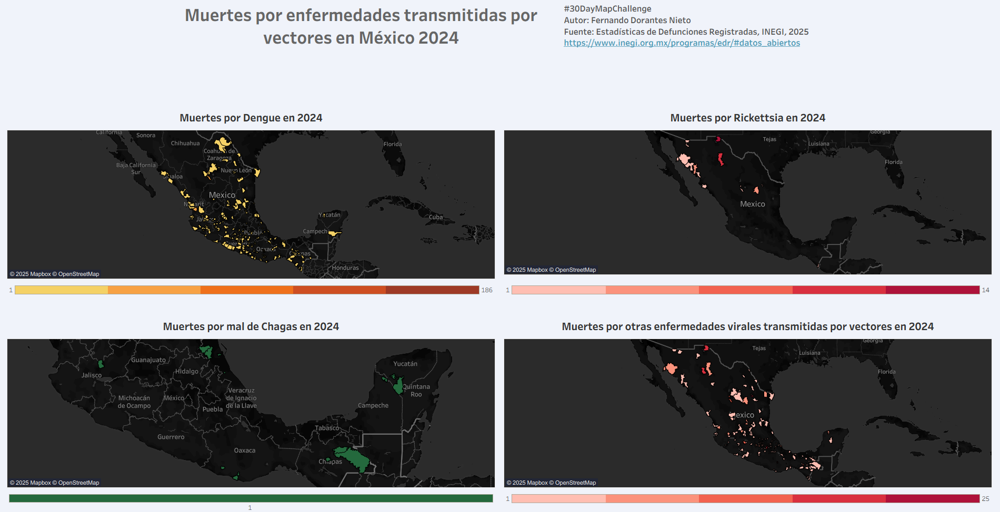

## Día 13:

## Día 14:

## Día 15:
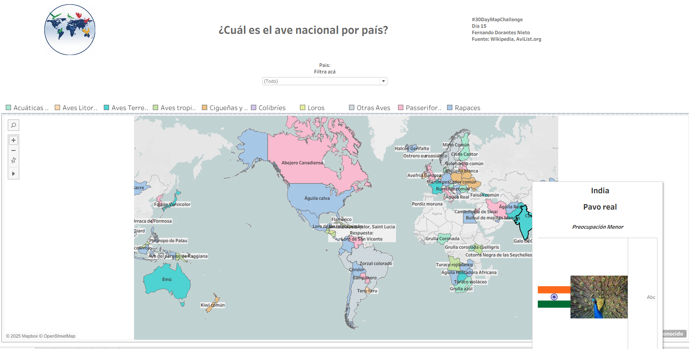

## Día 16:
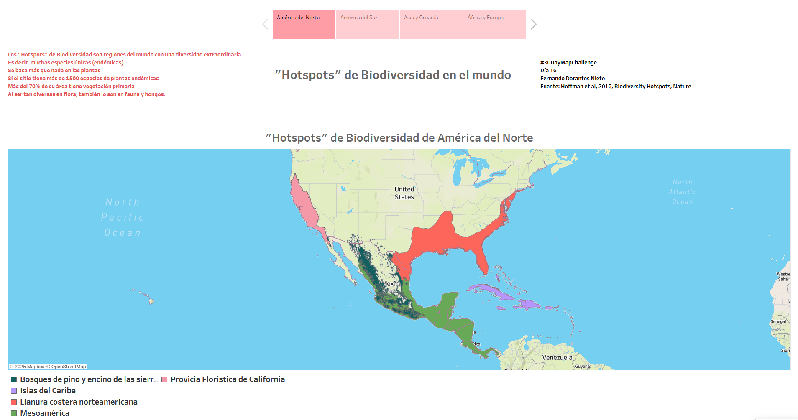

## Día 17:

## Día 18:
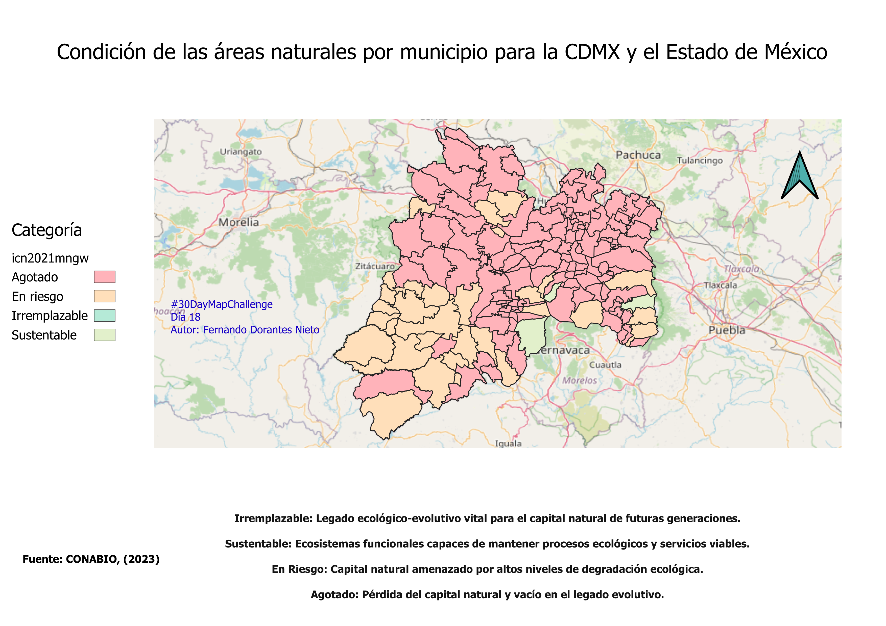

## Día 19:
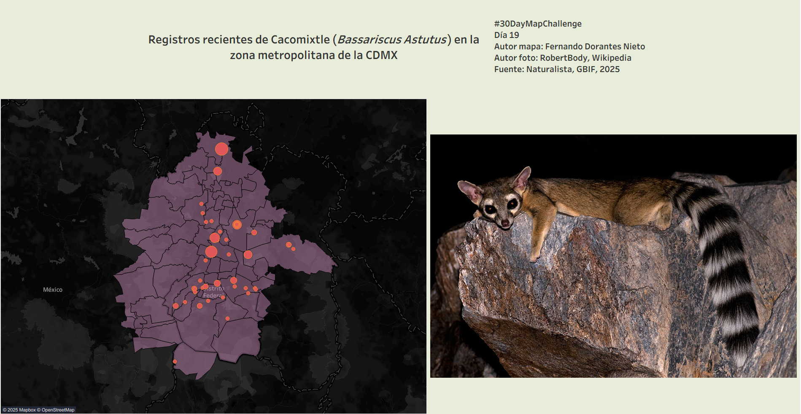

## Día 20:

## Día 21:
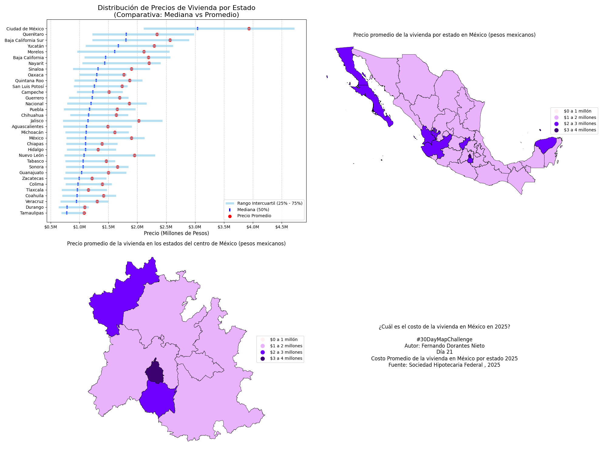

## Día 22:

## Día 23:
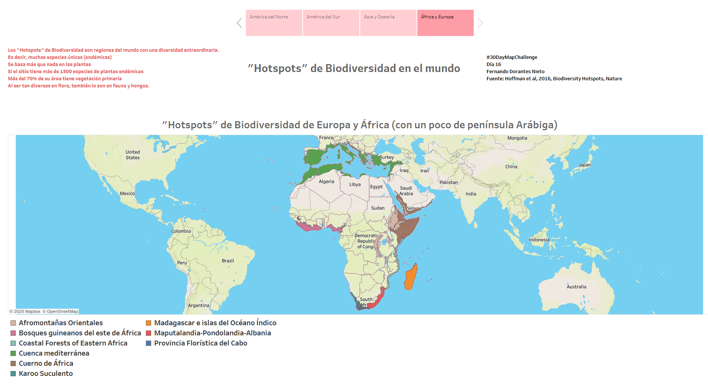

## Día 24:
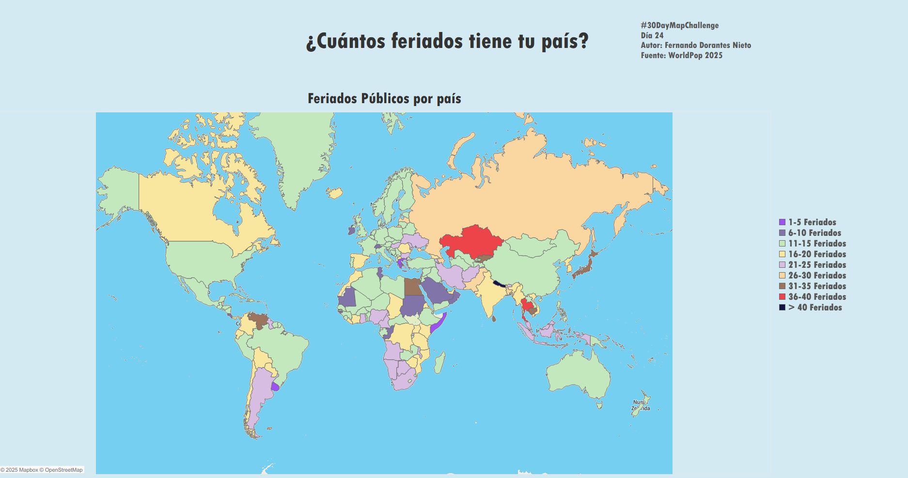

## Día 25:

## Día 26:

## Día 27:

## Día 28:

## Día 29:
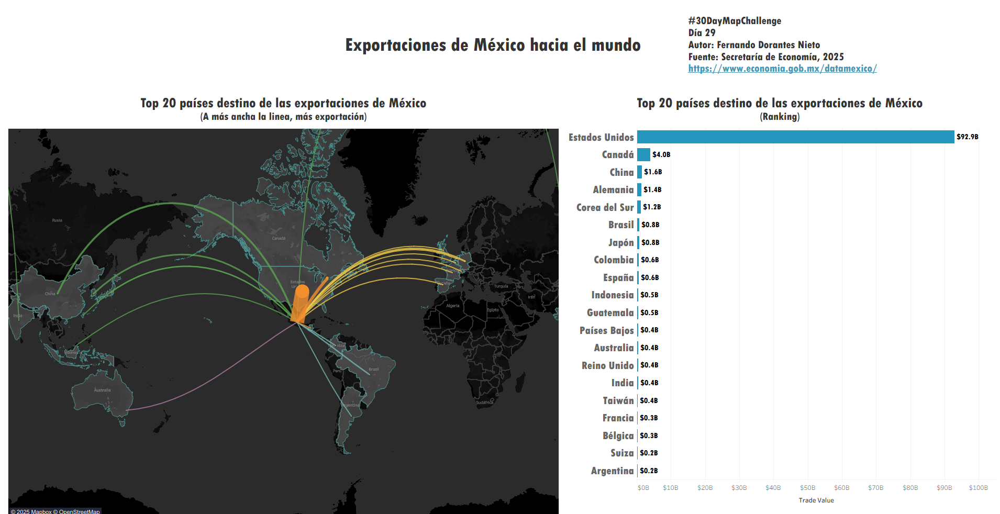

## Día 30:

